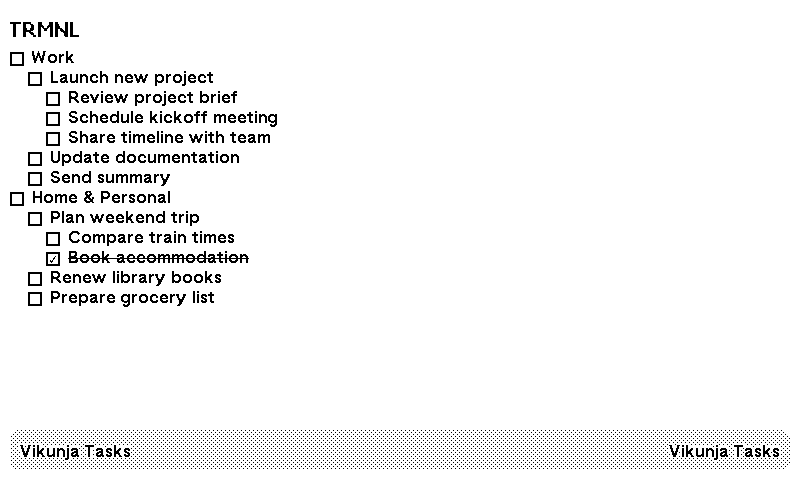

# Vikunja Tasks for TRMNL

Display tasks from your [Vikunja](https://vikunja.io/) projects on a [TRMNL](https://trmnl.com/) e-paper display. The plugin polls your Vikunja instance directly and uses the manual task order from the selected project view. No serverless transform is required.



## Features

- Show up to six projects, in the order configured.
- Display tasks with checkboxes and up to two levels of indented subtasks.
- Optionally show tasks completed today with checked boxes and strike-through text.
- Apply an optional Vikunja filter, such as `priority >= 3`.
- Use full, half-horizontal, half-vertical, or quadrant layouts. The full view flows down the left column, then into the right.

## Installation

1. Download the plugin ZIP from the [releases page](https://github.com/jaroslawhartman/trmnl-vikunja/releases).
2. In TRMNL, open **Private Plugins**, choose **Import new**, and select the ZIP. See [TRMNL's import guide](https://help.trmnl.com/en/articles/10542599-importing-and-exporting-private-plugins).
3. Configure the fields below, save, and preview or refresh the plugin.

TRMNL must be able to reach your Vikunja server. Create a Vikunja API token with permission to read the selected projects and tasks.

## Configuration

| Field | Value |
| --- | --- |
| Vikunja Server address | Your server's base URL, such as `https://vikunja.example.com`, without a trailing slash or `/api/v1`. |
| API Token | A Vikunja API token with read access. |
| Projects and views | Comma-separated `project ID:view ID` pairs, such as `8:53, 12:68`. |
| Done today | Enable to display tasks completed today. |
| Advanced filter | Optional [Vikunja API filter](https://vikunja.io/docs/filters/), for example `priority >= 3`. |

### Finding the project and view IDs

Open the desired project and list view in Vikunja and look at the browser address. For example:

```text
https://vikunja.example.com/projects/8/53
                                      ^  ^
                              project ID  view ID
```

Here, the project ID is **8** and the view ID is **53**, so enter `8:53` in **Projects and views**. The two IDs are different: use the view whose manual ordering you want to display. To show more than one project, enter each pair separated by a comma, for example `8:53, 12:68`.

## Behavior and limits

- Open tasks are requested in the selected view's `position` order. The selected view's own filters also apply.
- Completed-today tasks are fetched separately because the selected view may hide completed tasks. They appear after open tasks at their nesting level; their view-specific positions are unavailable from that endpoint. The separate request runs even when the switch is off, but its tasks are not displayed.
- Today is calculated using the TRMNL account's time zone. The advanced filter applies to both open and completed tasks.
- Up to two subtask levels are displayed. A task whose parent is not in the returned results appears as a root task; deeper descendants are not displayed.
- Only the first page of each task request is fetched, with up to 100 tasks per request, subject to server limits. Content that exceeds the screen is clipped.
- Project names and view IDs are not automatically resolved. If a project or view fails to load, check the IDs, token permissions, filter, server reachability, and TRMNL plugin logs.

## Development

The polling configuration and form fields are in `src/settings.yml`; `src/shared.liquid` contains the shared display logic, and the other Liquid files select a screen layout. Check changes in all four layouts in the TRMNL preview.
